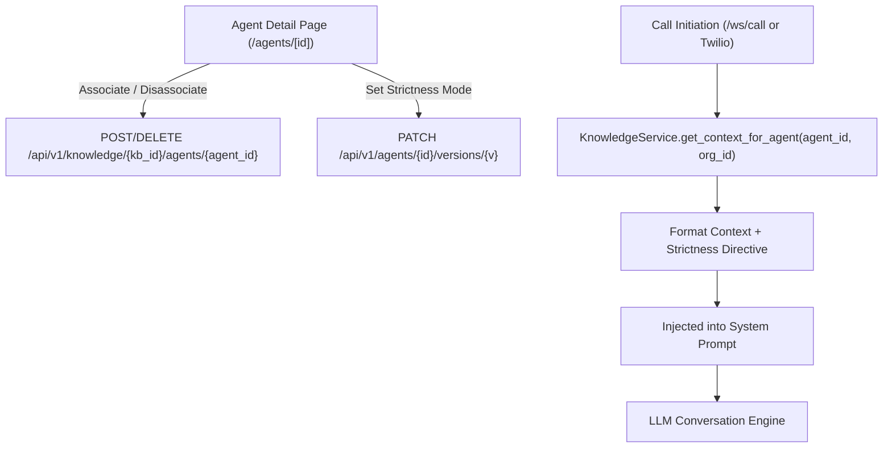

# Design: Agent Multi-KB Selector and Grounded Response Injection

## Intent and Context
Allow AI telecalling agents in the SaaS platform to have their own Knowledge Bases attached to them. When callers ask questions or raise objections during phone or browser calls, the agent's LLM generates responses grounded in the specific Knowledge Bases linked to that agent.

Users can also choose between **Strict Grounding** (never guess; politely offer follow-up if not in KB) and **Flexible Grounding** (prioritize KB, with natural conversational fallback).

## Goals
1. **Multi-KB Assignment**: Support associating zero, one, or multiple Knowledge Bases with an AI Agent in the frontend dashboard.
2. **Grounding Mode Selection**: Support two selectable knowledge behavior modes per agent:
   - `strict`: Stick strictly to facts in the KB. If the user asks something outside the KB, politely state that you'll have a team member follow up or verify the detail, rather than making up answers.
   - `flexible`: Use the KB facts as primary truth, but handle peripheral questions with warm, general conversational responses.
3. **Runtime Context Injection**: Automatically retrieve and format the associated KB documents into the LLM system prompt whenever an agent initiates a call (Browser WebSocket `/ws/call`, Twilio, and Campaign calls).
4. **End-to-End Testability**: Provide backend tests verifying context injection with both modes, and frontend UI to toggle/save associations.

## Non-Goals & Anti-Goals
- Vector database / RAG embeddings: For the MVP, text-based keyword & document concatenation (up to context budget) already works in `KnowledgeService`; no external vector DB dependencies (Pinecone, Chroma, etc.) will be introduced.
- Cross-tenant knowledge sharing: An agent can only link to KBs owned by the same organization.

## Architecture & Data Flow

## Detailed Decisions
1. **Strictness Mode Storage**:
   Stored in the active `AgentVersion.configuration["knowledge_strictness"]` (values: `"strict"` or `"flexible"`, default `"flexible"`).
2. **Prompt Composition**:
   In `backend/services/knowledge_service.py` (or caller helper), `get_context_for_agent`:
   - If documents exist:
     - Under `strict`:
       `# Reference Knowledge Base (Strict)\n{docs}\nCRITICAL INSTRUCTION: Answer questions about products, services, terms, and pricing ONLY using the facts in this reference knowledge base. If asked about something not in this knowledge, politely say you don't have that detail handy and offer to have a specialist follow up.`
     - Under `flexible`:
       `# Reference Knowledge Base\n{docs}\nINSTRUCTION: Use the above reference knowledge as your primary source of truth for facts, pricing, and answers. For general chit-chat or questions outside this knowledge, reply politely and helpfully.`
3. **Frontend Component**:
   In `frontend/app/(dashboard)/agents/[id]/page.tsx`, a dedicated "Knowledge Base" card with:
   - Checkboxes for each organization KB.
   - Radio / Select for Grounding Mode: "Flexible (Recommended)" vs "Strict Grounding".
   - Save button / auto-save syncing with API.
