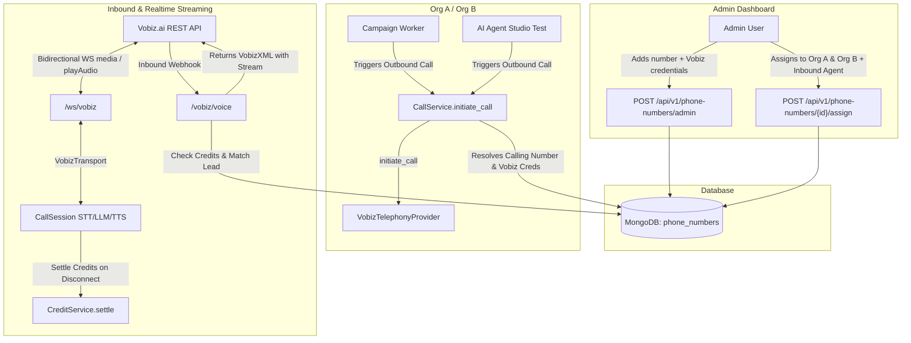

# Design: Vobiz.ai Phone Number Provider & Multi-Organization Assignment

## Intent and Context
Administrators purchase DID phone numbers directly from Vobiz.ai (vobiz.ai) and need to add and manage them in the Admin Dashboard **Phone Number Inventory**. 

Admins need to assign these Vobiz phone numbers to one or more organizations simultaneously, allowing those organizations to select them as their **Calling Number** when running outbound campaigns or executing live phone tests in the **AI Agent Studio**.

Furthermore, the integration supports customer inbound calls placed to these numbers, routing them to the designated inbound organization's AI agent over real-time WebSockets, while debiting the inbound organization's credit balance.

---

## Goals
1. **Admin Vobiz Configuration & Inventory Management**:
   - Provide first-class support for `provider: "vobiz"` in the Admin Phone Number Inventory.
   - When adding a Vobiz number (`POST /api/v1/phone-numbers/admin`), allow the admin to enter the number's specific Vobiz credentials:
     - `vobiz_auth_id`
     - `vobiz_auth_token`
     - (Optional) `vobiz_trunk_id` / label
   - Store these credentials securely in `provider_metadata` on the `PhoneNumber` document. Provider details must never be exposed to customer-facing APIs.

2. **Multi-Organization Assignment**:
   - Allow a single phone number to be assigned to multiple organizations simultaneously (`assigned_org_ids: list[str]`), maintaining backward compatibility with `organization_id` (pointing to the primary assigned org).
   - In the Admin Dashboard:
     - Update the "Assign Number" modal to support selecting multiple organizations.
     - Provide an option to designate which organization handles inbound calls (`inbound_organization_id`) and which specific agent answers (`inbound_agent_id`).
   - Customer-facing API (`GET /api/v1/phone-numbers` / `myNumbers`):
     - Return all phone numbers where `org_id` is present in `assigned_org_ids` (or matches `organization_id`).

3. **Vobiz Telephony Provider Adapter**:
   - Implement `VobizTelephonyProvider` (`backend/providers/telephony/vobiz.py`) inheriting from `TelephonyProvider`.
   - Implement `initiate_call(to, from_number, **kwargs)`:
     - Send `POST https://api.vobiz.ai/api/v1/Account/{auth_id}/Call/` with headers `X-Auth-ID` and `X-Auth-Token`.
     - Payload:
       ```json
       {
         "from": from_number,
         "to": to,
         "answer_url": "{public_base_url}/vobiz/voice?call_id={call_id}&agent_id={agent_id}&lang={lang}",
         "answer_method": "POST"
       }
       ```
     - Return `{ "provider_resource_id": call_id, "status": "queued" }`.
   - Implement `hangup_call` and `get_call_status` via Vobiz REST API by resolving credentials from the call record.

4. **VobizXML & Real-Time Media Stream (`/vobiz/voice` & `/ws/vobiz`)**:
   - `POST /vobiz/voice`: Responds with VobizXML instructing Vobiz to connect a bidirectional media stream to our WebSocket:
     ```xml
     <Response>
       <Stream bidirectional="true">wss://{public_host}/ws/vobiz?call_id={call_id}&amp;agent_id={agent_id}&amp;lang={lang}</Stream>
     </Response>
     ```
   - WebSocket `/ws/vobiz`:
     - Implements `VobizTransport` interfacing with `CallSession`.
     - Inbound frames:
       - `event: "start"`: Captures `streamId`, call metadata.
       - `event: "media"`: Decodes base64 8 kHz mu-law audio, resamples to 16 kHz PCM, feeds into `CallSession` (VAD / STT).
     - Outbound audio:
       - Receives 16 kHz PCM chunks from `CallSession` TTS, converts to 8 kHz mu-law, encodes to base64, and sends:
         ```json
         {
           "event": "playAudio",
           "streamId": streamId,
           "media": {
             "contentType": "audio/x-mulaw",
             "sampleRate": 8000,
             "payload": "<base64_data>"
           }
         }
         ```
     - Barge-in:
       - On interruption, sends `{ "event": "clearAudio", "streamId": streamId }` to immediately flush buffered audio on Vobiz.
     - Termination:
       - When WebSocket closes or receives disconnect, gracefully finalizes the `CallSession`.

5. **Inbound Call Handling, CRM Integration & Billing**:
   - If an inbound call hits `/vobiz/voice` without a `call_id`:
     - Look up the `PhoneNumber` in DB matching `number == To`.
     - Check `inbound_organization_id` (fallback to the first organization in `assigned_org_ids`).
     - **Credit Authorization**: Check if the organization has positive credits (`CreditService.can_start_call`). If credits <= 0, return VobizXML prompt:
       ```xml
       <Response>
         <Speak>This number is temporarily unavailable.</Speak>
         <Hangup/>
       </Response>
       ```
     - Reserve initial credits for the inbound call (`CreditService.reserve`).
     - Look up or create a `Lead` record for the caller (`phone == From`, `source="inbound"`) under `inbound_organization_id`.
     - Find the designated `inbound_agent_id` or the organization's primary active AI Agent.
     - Create an inbound `Call` record.
     - Return the VobizXML pointing to `/ws/vobiz` with the resolved `call_id`, `agent_id`, and `org_id`.
     - On WebSocket disconnect, finalize the call and settle consumed credits (`CreditService.settle`).

6. **Outbound Dispatch Integration (Campaigns & AI Studio)**:
   - **Centralized Dispatch in `CallService`**:
     - `CallService.initiate_call` handles looking up the `from_number` in `PhoneNumberRepository`.
     - If the number's provider is `"vobiz"`, it resolves the Vobiz credentials from `provider_metadata` and invokes `VobizTelephonyProvider.initiate_call`.
     - If provider initiation fails, it rolls back the credit reservation and marks the call record failed.
     - External callers (`CampaignWorker` and `/api/v1/calls/initiate`) remain completely agnostic of provider credentials.
   - **AI Agent Studio (`frontend/app/(dashboard)/agents/[id]/page.tsx`)**:
     - In the Phone test tab ("Call Your Real Phone"):
       - Fetch the organization's assigned numbers using `api.phoneNumbers.myNumbers()`.
       - Render a dropdown for the user to pick which assigned Calling Number to use as Caller ID (defaulting to the first available assigned number).
       - Initiate the call via `api.calls.initiate` using the selected number.

---

## Non-Goals & Anti-Goals
- **In-App DID Purchasing**: Admins purchase numbers directly from their Vobiz.ai console; the SaaS platform does not automate credit card purchases from Vobiz.
- **Exposing Provider Credentials**: Organizations / tenants must never see Vobiz account IDs, tokens, or provider internals in customer API responses.
- **Replacing Other Providers**: Twilio and Exotel remain fully functional; Vobiz.ai is added alongside them using the existing `TelephonyProvider` abstraction.

---

## Architecture & Data Flow



---

## Detailed Data Model & API Changes

### 1. Model Updates (`backend/models/phone_number.py`)
```python
class PhoneNumber(TimestampedModel):
    number: str
    display_name: Optional[str] = None
    country_code: str = "IN"
    number_type: str = "local"
    
    can_sms: bool = False
    can_voice: bool = True
    can_whatsapp: bool = False
    
    status: str = "available"  # available | assigned | suspended | maintenance
    organization_id: Optional[str] = None  # primary assigned org (for backwards compat)
    assigned_org_ids: list[str] = Field(default_factory=list)  # multi-org assignment
    inbound_organization_id: Optional[str] = None  # org that handles incoming calls
    inbound_agent_id: Optional[str] = None  # optional specific agent for incoming calls
    
    rental_paise_per_month: int = 0
    provider: str = "vobiz"  # twilio | exotel | vobiz | mock
    provider_resource_id: Optional[str] = None
    provider_metadata: dict = Field(default_factory=dict)
    # provider_metadata includes:
    # {
    #   "vobiz_auth_id": "...",
    #   "vobiz_auth_token": "...",
    #   "vobiz_trunk_id": "..."
    # }
```

### 2. Service & Repository Updates
- `backend/repositories/phone_number_repo.py`:
  - `list_for_org(org_id)`: query `{"$or": [{"organization_id": org_id}, {"assigned_org_ids": org_id}], "status": {"$in": ["assigned", "available"]}}`.
  - `assign_orgs(phone_number_id, org_ids, inbound_org_id=None, inbound_agent_id=None)`: updates `assigned_org_ids`, `organization_id` (to first org or inbound org), `inbound_organization_id`, `inbound_agent_id`, and sets `status = "assigned"`.
  - `unassign_org(phone_number_id, org_id)`: pulls `org_id` from `assigned_org_ids`; if empty, resets status to `"available"`.
- `backend/services/phone_number_service.py`:
  - `assign_to_orgs(phone_number_id, org_ids, inbound_org_id=None, inbound_agent_id=None, performed_by=None)`.
  - Customer view `_to_customer_view(pn)` guarantees `provider_metadata` (containing Vobiz keys) is never returned.

### 3. Vobiz Telephony Provider Adapter (`backend/providers/telephony/vobiz.py`)
- Implements `TelephonyProvider`.
- Takes `auth_id` and `auth_token` per call (passed via kwargs/phone number metadata).
- `initiate_call`:
  ```python
  async def initiate_call(self, to: str, from_number: str, **kwargs) -> dict:
      auth_id = kwargs.get("auth_id")
      auth_token = kwargs.get("auth_token")
      url = kwargs.get("url")
      headers = {
          "X-Auth-ID": auth_id,
          "X-Auth-Token": auth_token,
          "Content-Type": "application/json",
      }
      payload = {
          "from": from_number,
          "to": to,
          "answer_url": url,
          "answer_method": "POST",
      }
      async with httpx.AsyncClient(timeout=20.0) as client:
          res = await client.post(
              f"https://api.vobiz.ai/api/v1/Account/{auth_id}/Call/",
              headers=headers,
              json=payload,
          )
          res.raise_for_status()
          data = res.json()
          return {
              "provider_resource_id": data.get("call_id") or data.get("Call", {}).get("Sid") or data.get("id"),
              "status": "queued",
          }
  ```

### 4. Vobiz Webhook & WebSocket Streaming (`backend/telephony/vobiz.py`)
- Router prefix: `/vobiz` (routes: `POST /vobiz/voice`, WebSocket `/ws/vobiz`).
- `POST /vobiz/voice`:
  - Inbound & outbound webhook handler returning VobizXML with `<Stream bidirectional="true">wss://{host}/ws/vobiz?...</Stream>`.
- `WebSocket /ws/vobiz`:
  - Accepts connection and starts `CallSession` with `VobizTransport`.
  - Handles JSON frames from Vobiz:
    - `"start"`: reads `streamId`.
    - `"media"`: decodes `payload` (mu-law 8kHz -> PCM16 16kHz) and sends to `session.push_audio()`.
  - Sends outbound chunks to Vobiz via `"playAudio"` events.
  - Sends `"clearAudio"` on speech interrupt (barge-in).
  - Settles credits via `CreditService.settle()` on disconnect.

### 5. Frontend Admin Dashboard Updates (`frontend/app/(admin)/admin/phone-numbers/page.tsx`)
- **Add Number Modal**:
  - Provider dropdown includes: `vobiz`, `twilio`, `exotel`, `mock`.
  - When `vobiz` is selected:
    - Inputs for `Vobiz Auth ID` (required) and `Vobiz Auth Token` (required, password/masked toggle).
    - Passed to `api.phoneNumbers.addAdmin` under `provider_metadata`.
- **Assign Number Modal**:
  - Multi-select organization picker (select 1 or more organizations).
  - Inbound Organization picker (select which of the assigned organizations receives inbound calls).
  - Inbound Agent picker (select which agent from the chosen organization answers incoming calls).
- **Inventory Table**:
  - Displays assigned organizations as badges or count (e.g. "3 orgs").
  - Shows Provider badge (`vobiz`).

### 6. Frontend AI Agent Studio Updates (`frontend/app/(dashboard)/agents/[id]/page.tsx`)
- In `testTab === "phone"`:
  - Load available assigned numbers for the organization using `api.phoneNumbers.myNumbers()`.
  - Replace the static phone icon / hardcoded `from_number: "+911234567890"` with a dropdown to select the Calling Number.
  - Call `api.calls.initiate({ to_number, from_number: selectedCallingNumber, agent_id, agent_version })`.
